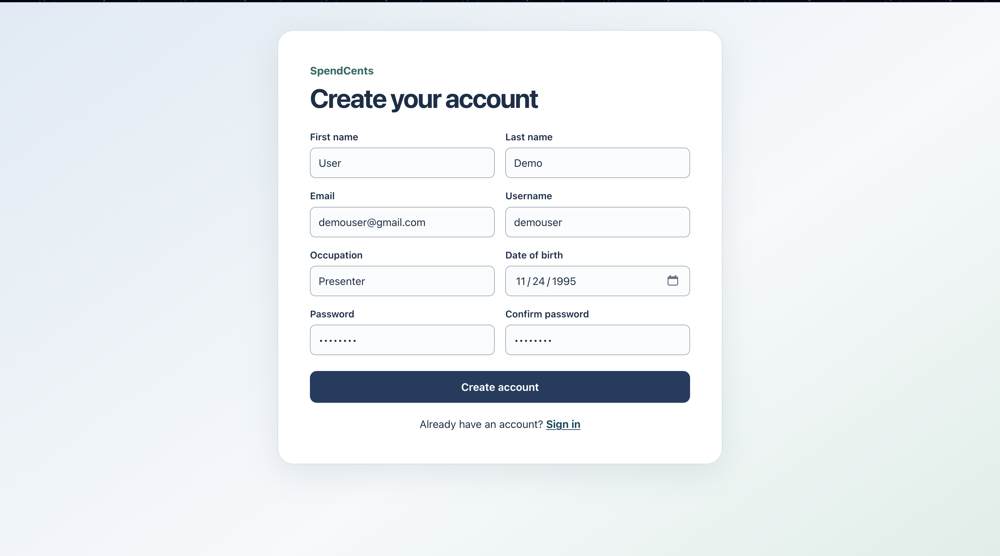
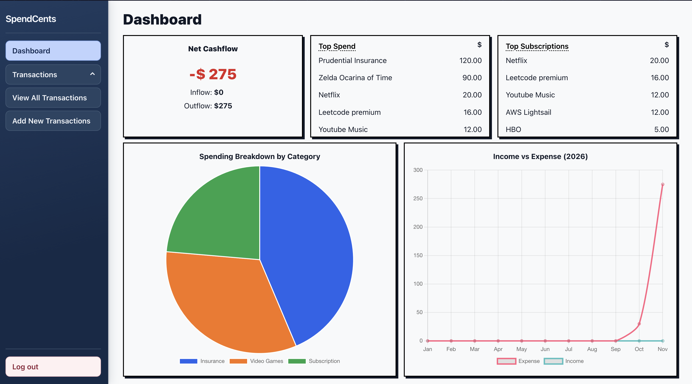
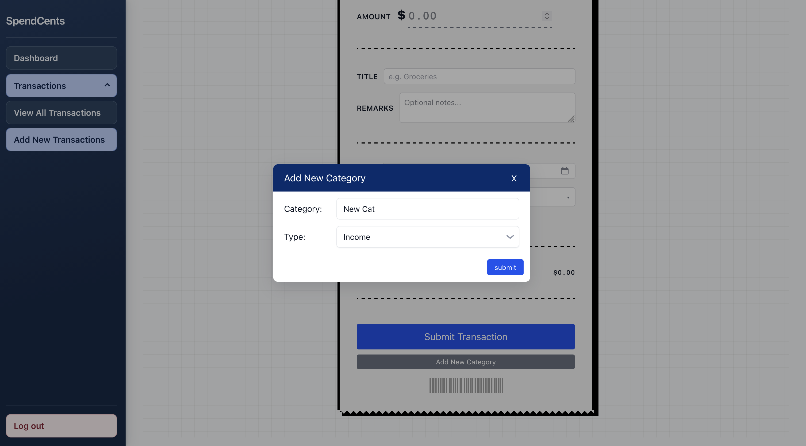
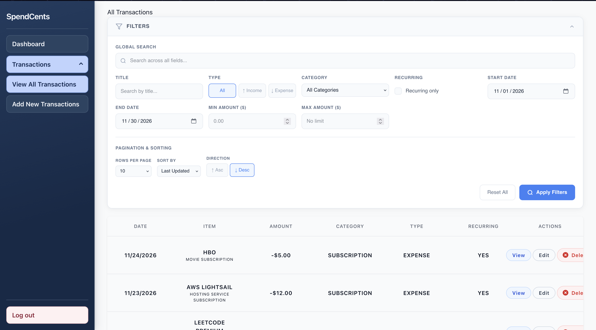
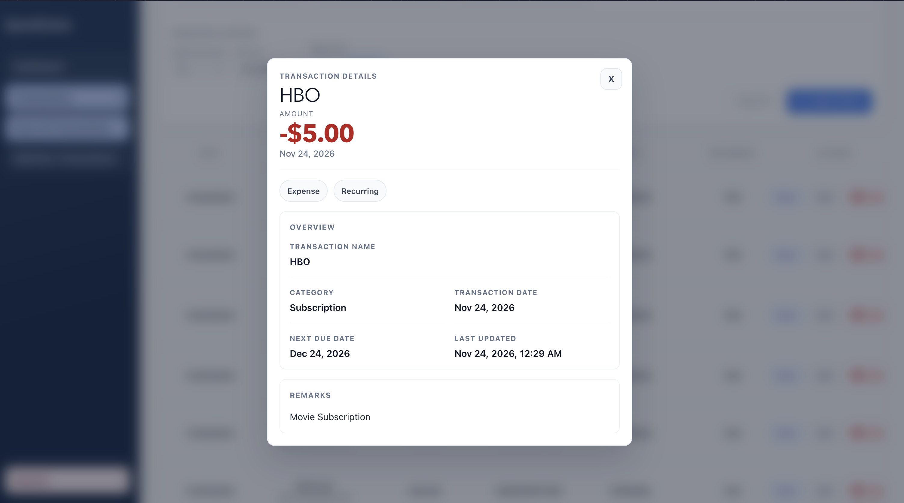
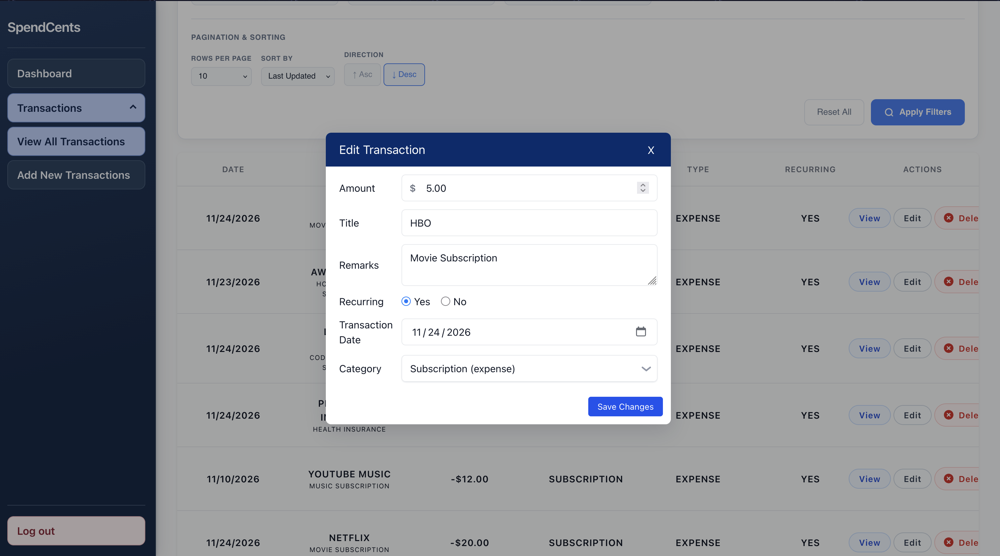
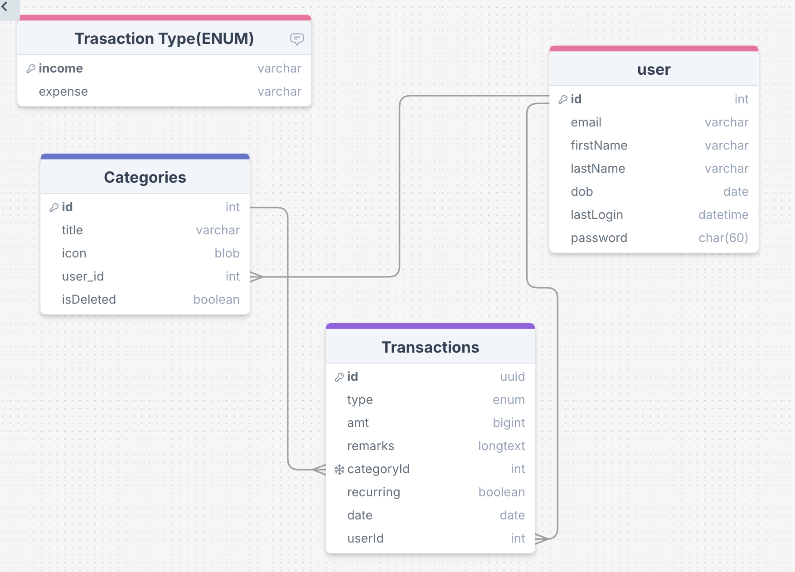

<h1> SpendCents </h1> 
<h2> Personal project of a responsive expense tracker to track expenditure and perform CRUD operations</h2>

*Stack : Java, Springboot, React, Typescript, Redux, Redis, MySQL and AWS*

Check it out at: [spendcents.surenk.dev](https://spendcents.surenk.dev)

Key Features: 
1. CRUD functionality on expenses 
2. Visualisation of spending habits 
3. User Authentication

## Screenshots

### Login

### Registration

### Dashboard

### Add a custom category

### Past transactions

### View a transaction

### Edit a transaction

## Database schema

